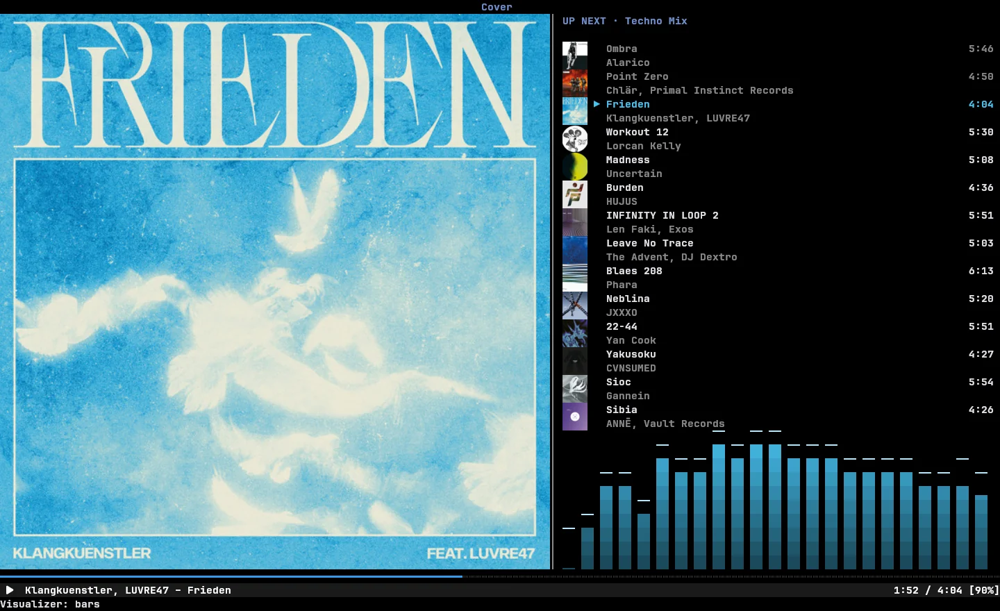
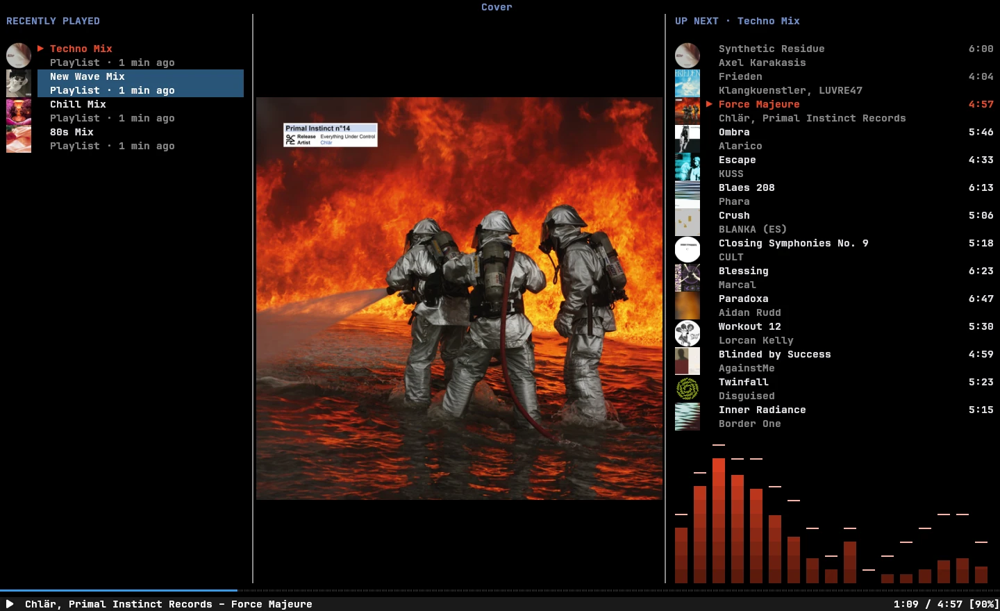
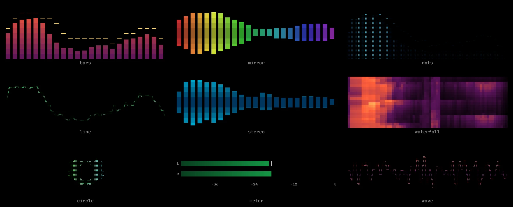
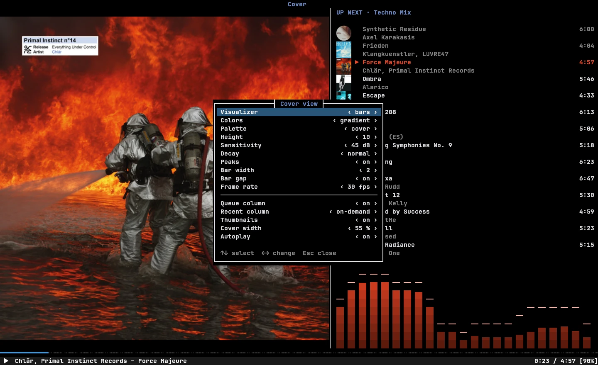
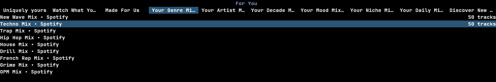
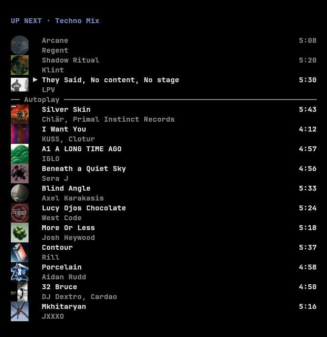

<div align="center">

# ncspot plus

A fork of [ncspot](https://github.com/hrkfdn/ncspot), the Spotify client for the terminal.<br>
Album art with the queue and a live visualizer, your Made For You mixes and autoplay.



<sub>The cover view (<kbd>F8</kbd>). <kbd>v</kbd> switches between the nine visualizer styles.</sub>

</div>

## What the fork adds

| | ncspot | This fork |
|---|---|---|
| Cover view (<kbd>F8</kbd>) | Album art | Album art, queue, recently played, thumbnails and visualizer |
| Audio visualizer | – | 9 styles, in sync with what you hear |
| Settings | `config.toml` | Also a dialog in the app, changes apply at once |
| Made For You | Browse tab is [empty](https://github.com/hrkfdn/ncspot/issues/1717) | Own page (<kbd>F4</kbd>) with every shelf |
| End of the queue | Playback stops | Autoplay continues with similar tracks |
| Daily Mix, Discover Weekly, … | Can stay empty or [outdated](https://github.com/hrkfdn/ncspot/issues/464) | Loaded through the Spotify session, fresh on every start |

Everything else is ncspot as you know it: library, search, playlists, vim keys,
IPC socket, small footprint.

## Now playing

The cover view turns into a full screen for the music that is playing: the
cover in the middle, the queue with small covers on the right and the
recently played tracks on the left (<kbd>Ctrl</kbd>+<kbd>←</kbd>).



- The queue header shows where playback started, e.g. "UP NEXT · Techno Mix".
- Played tracks stay in the list, dimmed, so you can go back to them.
- Arrow keys skip, seek and change the volume, <kbd>Enter</kbd> plays the
  selected track, <kbd>d</kbd> removes it.

## Visualizer

The visualizer analyses the audio that is actually played and waits for the
output buffer, so the bars move with what you hear. Nine styles, four color
modes and six palettes, one of them taken from the album art.



## Settings without a config file

<kbd>,</kbd> opens a dialog for everything in the cover view. Changes show up
immediately and are saved.



## For You

<kbd>F4</kbd> opens Spotify's Made For You page: Daily Mixes, Discover Weekly,
Release Radar, On Repeat, daylist, genre and mood mixes, one tab per shelf,
including the ones you don't follow.



## Autoplay



When the queue runs out, about 30 similar tracks are appended, like in the
official apps. They are based on the playlist or album you started and on
what you played recently, and they show up below an "Autoplay" divider.

Autoplay is off while repeat is on, and `autoplay = false` turns it off
completely.

<br clear="right">

## Install

The fork runs on Linux and macOS and needs Spotify Premium. Install the
[build dependencies](doc/developers.md#prerequisites) of ncspot, then:

```sh
git clone https://github.com/axbhr/ncspot-plus
cd ncspot-plus
cargo install --path . --locked --features cover
```

The program is still called `ncspot` and uses the same configuration and
cache, so it replaces an existing installation. The packages on Homebrew,
Flathub and others install the original ncspot.

The album art and thumbnails need a terminal with the kitty graphics protocol,
such as kitty, Ghostty or WezTerm. Other terminals show the cover the way
ncspot does and leave out the thumbnails.

| Key | Action |
|---|---|
| <kbd>F8</kbd> | Cover view |
| <kbd>F4</kbd> | For You |
| <kbd>Ctrl</kbd>+<kbd>←</kbd> / <kbd>Ctrl</kbd>+<kbd>→</kbd> | Recently played / queue |
| <kbd>v</kbd> | Next visualizer style |
| <kbd>,</kbd> | Settings |

All keys, settings and options are in [doc/fork.md](doc/fork.md).

## About ncspot


ncspot is an ncurses Spotify client written in Rust using librespot, by
[hrkfdn](https://github.com/hrkfdn) and contributors. It is inspired by ncurses
MPD clients such as [ncmpc](https://musicpd.org/clients/ncmpc/) and aims to be
a simple and resource friendly alternative to the official client.

- Tracks, albums, artists, playlists, podcasts and search
- Small [resource footprint](doc/resource_footprint.md)
- Vim keybindings out of the box
- IPC socket for remote control

Configuration lives in `~/.config/ncspot`, see the
[user documentation](doc/users.md#configuration). More on building is in
[doc/developers.md](doc/developers.md), packaging notes are in
[doc/package_maintainers.md](doc/package_maintainers.md).
