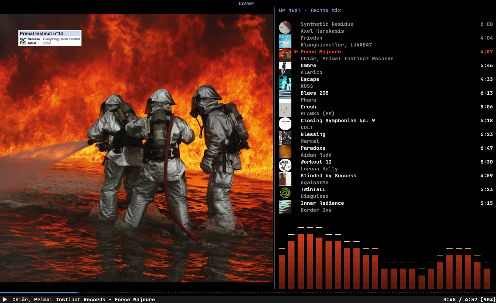
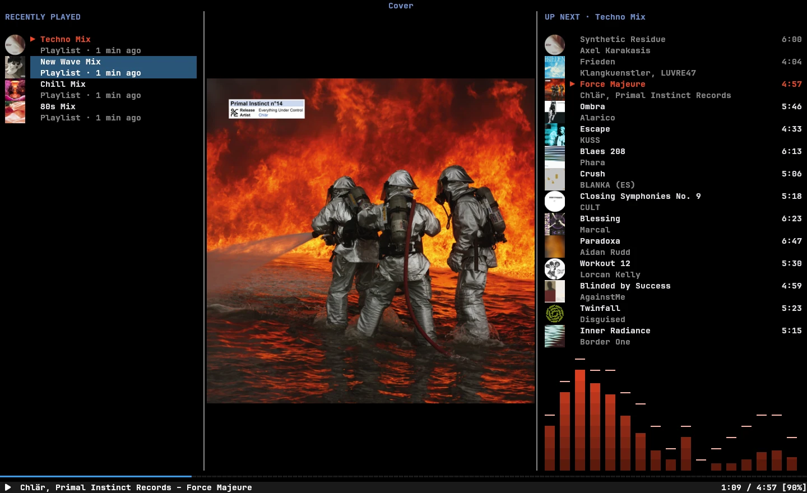
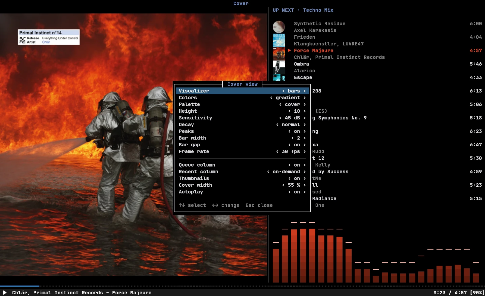
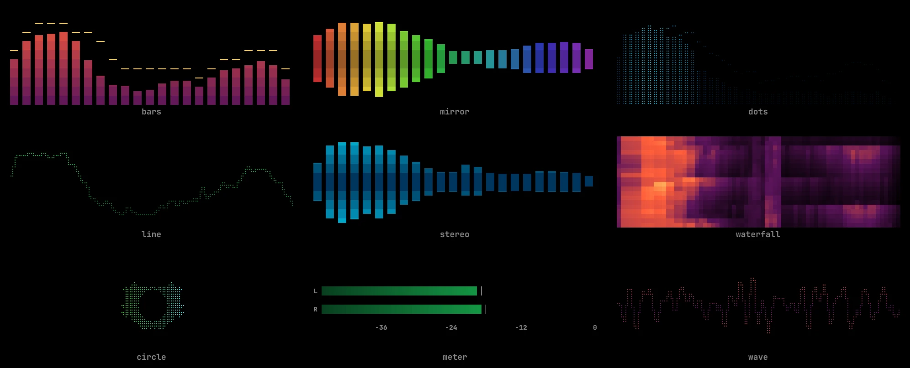
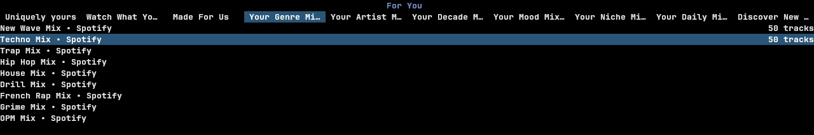

# Fork additions

This fork of [ncspot](https://github.com/hrkfdn/ncspot) extends the cover
view into a full "now playing" screen and adds Spotify features that the
restricted Web API no longer offers. Everything else behaves like upstream.

## Building

The additions live behind the `cover` feature:

```sh
cargo install --path . --locked --features cover
```

Build dependencies are the same as upstream, see
[developers.md](developers.md). The fork targets Linux and macOS. On
Windows the `cover` feature does not build (as in upstream), so only For
You, autoplay and Spotify's own playlists are available there.

Album art and thumbnails need a terminal with the kitty graphics protocol.
This is tested with kitty; Ghostty and WezTerm implement the protocol too. Other terminals fall back to upstream's
sixel or block rendering for the main cover and show no thumbnails.

## Cover view (F8)



The view has three parts: recently played on the left, the cover in the
middle and the queue with a visualizer on the right. By default the left
column only appears while it has focus.



| Key | Cover | Queue / Recently played |
|---|---|---|
| <kbd>Ctrl</kbd>+<kbd>←</kbd> / <kbd>Ctrl</kbd>+<kbd>→</kbd> | Focus recently played / queue | Back to the cover |
| <kbd>Space</kbd> | Play/pause | Play/pause |
| <kbd>→</kbd> / <kbd>←</kbd> | Next / previous track (restart after 3 s) | |
| <kbd>Shift</kbd>+<kbd>→</kbd> / <kbd>Shift</kbd>+<kbd>←</kbd> | Seek 10 s | |
| <kbd>↑</kbd> / <kbd>↓</kbd> | Volume ±5 % | Move the selection (also <kbd>k</kbd>/<kbd>j</kbd>) |
| <kbd>Enter</kbd> | Play/pause | Play the selected track or playlist |
| <kbd>d</kbd> | Unsave the current track | Remove the selected track from the queue |
| <kbd>Esc</kbd> | | Back to the cover |
| <kbd>v</kbd> | Next visualizer style | Next visualizer style |
| <kbd>,</kbd> | Settings dialog | Settings dialog |

The queue header shows the playlist or album playback was started from.
Played tracks stay in the list, dimmed above the current one, so you can
select them to go back. Tracks added by autoplay are listed below an
"Autoplay" divider.

### Settings dialog

<kbd>,</kbd> opens a dialog for everything in the cover view: <kbd>↑</kbd>/<kbd>↓</kbd>
select, <kbd>←</kbd>/<kbd>→</kbd> change, <kbd>Esc</kbd> closes. Changes apply
at once and are saved to `cover.toml` in the configuration directory. Once
that file exists it takes precedence over the matching `config.toml` options
below. Delete it to go back to them.



| Setting | Values |
|---|---|
| `visualizer` | `bars`, `mirror`, `dots`, `line`, `stereo`, `waterfall`, `circle`, `meter`, `wave`, `off` |
| `color_mode` | `solid`, `gradient` (bottom to top), `rainbow` (by frequency), `heat` (by loudness) |
| `palette` | `theme`, `cover` (dominant color of the album art), `spotify`, `sunset`, `ocean`, `mono` |
| `visualizer_height` | Rows, 2–20 |
| `sensitivity` | Dynamic range in dB, 25–70 |
| `decay` | `slow`, `normal`, `fast` |
| `peaks` | Falling peak markers |
| `bar_width`, `bar_gap` | Bar width 1–3 and a gap between bars |
| `fps` | 30 or 60 |
| `queue_panel` | Queue column |
| `recent_panel` | `on-demand` (only while focused), `always`, `off` |
| `thumbnails` | Small covers in the columns |
| `split` | Share of the free width used by the cover, 0.3–0.75 |
| `autoplay` | See below |

### Visualizer

The visualizer analyses the audio that is actually played: the samples are
copied from the audio sink and delayed by the output buffer, so the bars
match what you hear. With the `theme` palette it uses the theme colors
`visualizer` and `visualizer_peak`.



## For You (F4)

The shelves of Spotify's Made For You page (Daily Mixes, Discover Weekly,
Release Radar, On Repeat, daylist, genre and mood mixes), one tab each, also
the ones you do not follow. <kbd>Enter</kbd> plays a playlist, <kbd>o</kbd>
opens it, <kbd>Shift</kbd>+<kbd>U</kbd> reloads the page.



The page comes from Spotify's internal GraphQL API ("Pathfinder") through a
persisted query. Spotify retires these from time to time. If the view reports
that Spotify refused the request, set the current hash of the `browsePage`
query as `pathfinder_browse_hash` in `config.toml`.

## Autoplay

When the queue runs out, about 30 similar tracks are appended, like the
official clients do. They are based on the playlist or album playback started
from and the recently played tracks. Autoplay is off while repeat is on.

## Spotify's own playlists

Playlists owned by Spotify (Daily Mix, Discover Weekly, …) are loaded through
the librespot session instead of the Web API, which no longer serves them to
most clients. The session is also the fallback when the Web API fails for
any other playlist. Spotify's playlists are refreshed once per run, since
Spotify regenerates them without changing their snapshot id.

## Configuration

New `config.toml` options. They are the starting values of the settings
dialog.

| Option | Default |
|---|---|
| `cover_queue` | `true` |
| `cover_split` | `0.55` |
| `visualizer` | `"bars"` |
| `visualizer_height` | `8` |
| `autoplay` | `true` |
| `pathfinder_browse_hash` | built in |

New theme keys: `visualizer`, `visualizer_peak`.

## Caveats

Autoplay, For You and the session-based playlist loading use Spotify
endpoints that are not publicly documented. They work like the official
clients but can change without notice.

## Credits

The Pathfinder `browsePage` request and its persisted query hash follow
[spotatui](https://github.com/LargeModGames/spotatui).
